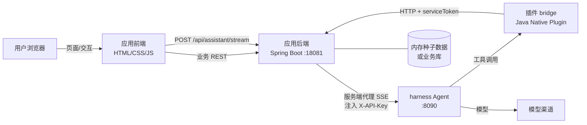
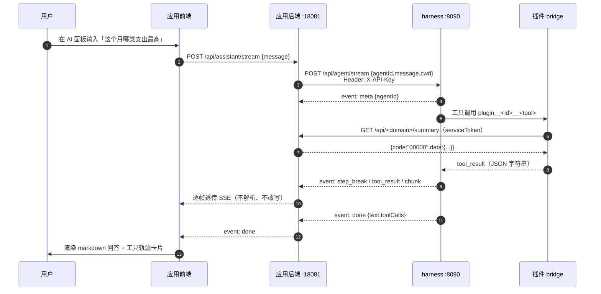

# 架构：应用为主体 + 内嵌 AI 助手

本技能交付的不是「Agent 的界面」，而是**一个业务应用**，AI 能力以助手形态嵌在应用里；插件只是应用与 harness Agent 之间的**桥**。
所有端点、事件名、字段都以下列代码为准（仓库内路径为证据）：

- Agent 对话：`jnf-harness/jnf-harness-trigger/src/main/java/com/jnf/harness/trigger/http/AgentController.java`
- SSE 映射：`jnf-harness/jnf-harness-trigger/src/main/java/com/jnf/harness/trigger/service/stream/AgentStreamApi.java`
- 插件管理：`jnf-harness/jnf-harness-trigger/src/main/java/com/jnf/harness/trigger/http/HarnessPluginController.java`
- 插件端点宿主：`jnf-harness/jnf-harness-trigger/src/main/java/com/jnf/harness/trigger/http/PluginApiController.java`
- 鉴权/CORS：`jnf-harness/jnf-harness-trigger/src/main/java/com/jnf/harness/trigger/filter/ApiKeyAuthInterceptor.java`、`WebMvcConfig.java`
- 桌面端 SSE 解析（可参照）：`jnf-desktop/src/lib/agent-client.ts`

## 1. 三层结构



三层职责：

| 层 | 职责 | 不该做的事 |
| --- | --- | --- |
| 应用 UI/业务 API | 产品界面、业务数据、业务校验、AI 面板、SSE 代理 | 不直连 8090、不持有 harness API Key |
| 插件 bridge | 把应用 API 暴露成 Agent 工具；系统提示词边界；异常分类与脱敏 | 不直连数据库、不在插件里复制业务逻辑 |
| harness Agent | 会话编排、模型调用、工具分发、SSE 推送 | 不画界面、不存业务数据 |

## 2. 端到端时序（最关键的一张图）



要点：
1. **浏览器只认识应用域**。所有 harness 调用由应用服务端发起，API Key 只存在服务端配置里；
2. 代理层**逐字节转发** SSE（不要自己解析再重编码），只负责注入鉴权头与转发 body；
3. 插件回源应用 REST，**不共享内存**：应用重启、插件重载都互不影响；
4. `done` 之后流才关闭；面板以 `done.text` 为准，勿用累积 chunk 覆盖（防重复帧）。

## 3. 契约表

### 3.1 harness 侧（底座提供，不要改）

| 项 | 值 |
| --- | --- |
| 对话（流式） | `POST /api/agent/stream`，body `{agentId,message,model?,maxTokens?,temperature?,cwd?,profile?,thinking?,attachments?}` |
| 对话（阻塞） | `POST /api/agent/message`，信封返回 `data=AgentRunResult{agentId,turn,status,text,toolCalls[]}` |
| 状态/取消 | `GET /api/agent/{agentId}/status`、`POST /api/agent/{agentId}/cancel` |
| 健康 | `GET /actuator/health`（免鉴权） |
| 鉴权 | 请求头 `X-API-Key: <key>` 或 `Authorization: Bearer <key>`；`harness.auth.api-keys` 为空时放行 |
| 响应信封 | `{code,info,data}`；`00000` 成功 / `40000` 参数错 / `50000` 内部错；**HTTP 恒 200** |
| SSE 事件 | `meta`/`chunk`/`thinking`/`step_break`/`tool_result`/`usage`/`finish`/`done`/`error`，`data` 为 JSON；每 15s 一条 `:keepalive` 注释帧 |
| 插件管理 | `/api/harness/plugins`：`GET` 列表、`GET /catalog`、`POST /install`、`POST /activate`、`POST /{id}/reload`、`GET /{id}/contributions` |
| 插件业务端点 | `/api/harness/plugins/{pluginId}/api/{path}`（`{path}` 单段最稳，精确匹配；查询串可传，路径变量不参与匹配） |

`attachments` 是图片附件数组 `[{mediaType,data}]`（`data` 为裸 base64 或 data URI），模型不支持图片输入时底座直接返回 `40000`；文本场景不要传。

### 3.2 应用侧（本技能要实现的）

| 项 | 约定 | 说明 |
| --- | --- | --- |
| 业务 REST | `/api/<domain>/...`，信封 `{code,info,data}` | 供前端与插件共用，口径必须一致 |
| AI 代理 | `POST /api/assistant/stream` | 入参 `{message, agentId?, cwd?}`，出参纯 SSE |
| 插件鉴权 | 只对插件路径校验 `serviceToken`（请求头 `X-Service-Token`） | 前端路径不校验，避免误伤 |
| 应用端口 | `--server.port=18081` 起顺延 | 显式传参，不吃环境变量 |
| 数据 | 内存 `Map` + 启动种子 | 重启还原，演示与验收可重复 |

### 3.3 插件配置（写入宿主 KV，工具执行时读取）

| 配置键 | 示例 | 用途 |
| --- | --- | --- |
| `baseUrl` | `http://127.0.0.1:18081` | 应用 REST 根地址（**不要写死在代码里**） |
| `serviceToken` | `<token>` | 插件调应用时带 `X-Service-Token` |
| `timeoutMs` | `3000` | HTTP 超时，默认 3s |

读写方式：`PUT /api/harness/plugins/{id}/config`，body 为 `Map<String,String>`；插件侧 `getConfig("baseUrl", "http://127.0.0.1:18081")`。`configure()` 里缓存的旧值要 `POST /{id}/reload` 才刷新。

### 3.4 harness URL / API Key 的注入方式

| 位置 | 形态 | 说明 |
| --- | --- | --- |
| 应用 `application.yml` | `harness.base-url: ${HARNESS_BASE_URL:http://127.0.0.1:8090}` | 应用服务端读 |
| 应用 `application.yml` | `harness.api-key: ${HARNESS_API_KEY:}` | **服务端专用**，空串=底座未开鉴权 |
| 应用 `application.yml` | `harness.agent-id: ${HARNESS_AGENT_ID:app-assistant}` | 同一应用固定一个 agentId，便于连续对话 |
| 进程环境变量 | `HARNESS_BASE_URL` / `HARNESS_API_KEY` | 换环境不改代码、不改产物 |

### 3.5 workspace / cwd

`cwd` 会决定底座看到的技能目录（`<cwd>/.jnf/skills`）。代理透传 `cwd` 时：
- 传**应用自己登记的绝对工作目录**（默认取应用启动目录即可），不要拼用户输入；
- 不传则用底座进程 cwd；插件工具里的相对路径以 `ctx.cwd()` 为基准；
- 交付时在 README 写明底座与应用的启动目录，避免「技能/插件找不到」。

## 4. 部署拓扑（本地默认）

```text
<workspace>/
├─ jnf-harness/                      # 底座源码
│  └─ jnf-harness-app/target/
│     ├─ jnf-harness-app.jar         # 进程 A：java -jar ... --server.port=8090
│     └─ plugins/<your-plugin>.jar   # jar 同级 plugins/ 启动自动装载
└─ <app-dir>/
   ├─ <app>/target/<app>.jar         # 进程 B：java -jar ... --server.port=18081
   └─ <plugin>/target/<plugin>.jar   # 构建产物，复制到插件目录
```

- 两个进程、两个端口；插件**不需要**成为底座 Maven 子模块；
- 数据目录 `./data` 相对各进程 cwd：底座数据在底座启动目录，应用数据在应用启动目录；
- 换机器/换目录启动前先确认端口占用与插件目录解析（`harness.plugins.dir` → jar 同级 `plugins/` → `./plugins`）。

## 5. 失败模式与定位顺序

| 现象 | 先查 | 再查 |
| --- | --- | --- |
| AI 面板报错 | 应用代理日志：harness 是否可达、key 是否正确 | 底座 `/actuator/health`、模型渠道是否配置 |
| AI 说「我没有数据」但页面有 | 插件是否 ACTIVE、`/contributions` 工具是否存在 | 工具 `description` 是否写清「必须调用查证」 |
| 工具报连接失败 | 插件配置 `baseUrl` 是否指向运行中的应用 | 应用 `serviceToken` 是否与插件配置一致 |
| 插件没出现 | 插件目录解析路径、jar 是否含 `plugin.yaml` 与 SPI 文件 | `/catalog` 是否扫到、日志是否有 warn |
| 回答数字与页面不一致 | 是否走了同一条 REST/service | 汇总是否由明细实时计算 |

## 6. 给用户讲架构时的三句话

1. 应用负责业务与界面，AI 只是嵌在应用里的助手；
2. 插件是「应用能力的翻译层」，把 REST 翻译成 Agent 能调用的工具；
3. 模型不直接碰数据：每一次回答都要经过工具回源应用，所以数字可追溯。
